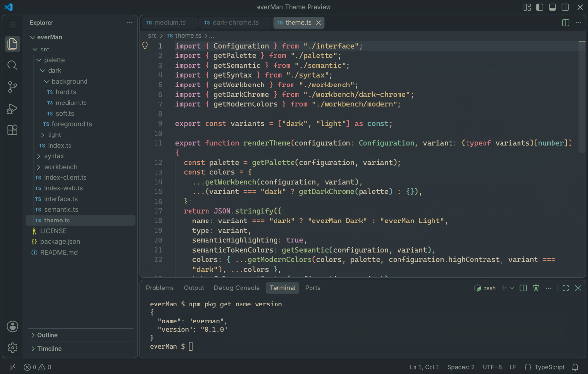

# everMan

An Everforest-based theme for modern VS Code, with dark and light variants.



## Install

You only need VS Code and a prebuilt `.vsix` file see the releases

1. Get the latest release
2. In VS Code, press **Ctrl+Shift+P** and run **Extensions: Install from VSIX...**
3. Select `everman-<version>.vsix`.

## Build a VSIX from source

From the source folder, run this in Bash with Node.js 22+ and the VS Code `code` command on your PATH:

```bash
npm ci &&
    npm run package &&
    code --install-extension "everman-$(node -p "require('./package.json').version").vsix" --force
```

This builds the VSIX and installs it in VS Code, replacing any installed copy of the same version.

## Customize

Search for `@ext:karavellas.everman` in VS Code's **User** settings. If you're migrating from Everforest, rename `everforest.*` settings to `everMan.*`. Choose **Reload** when prompted.

Based on [Everforest for VS Code](https://github.com/sainnhe/everforest-vscode), commit `b17f8af`, by Sainnhe Park. MIT licensed.
